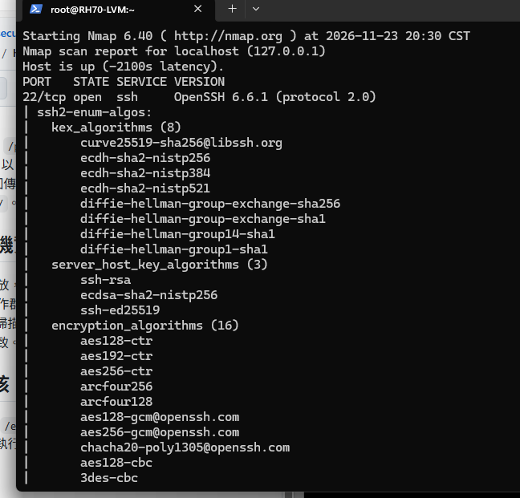
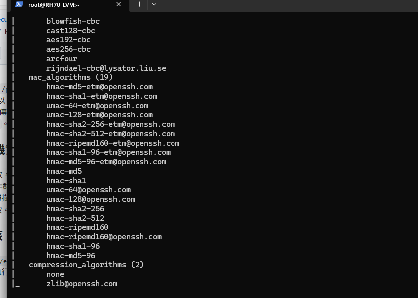
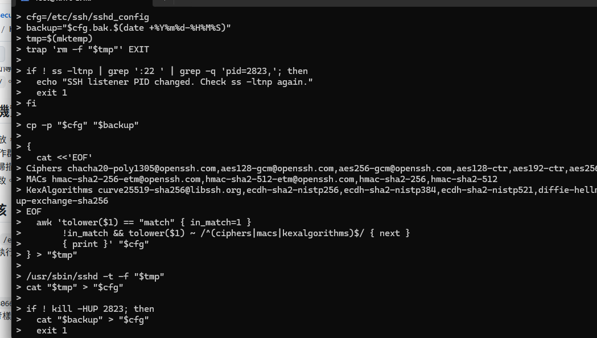
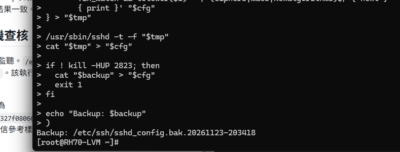
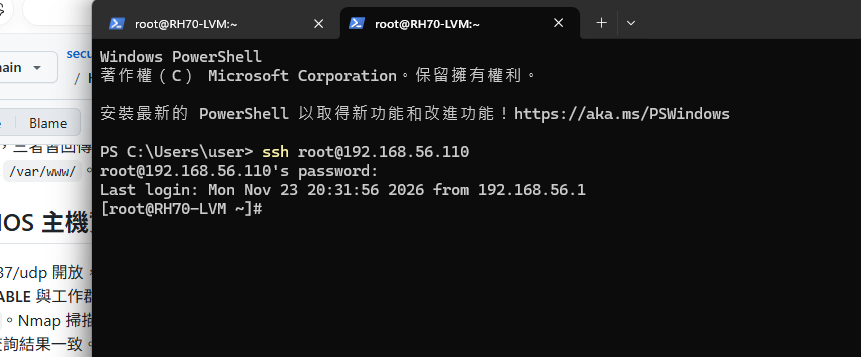

# SSH 演算法安全設定實驗報告

## 實驗環境與目標

在 VirtualBox 的 RH70-LVM（CentOS 7）上檢查 OpenSSH 6.6.1。以 Nmap 6.40 的 ssh2-enum-algos 比較 TCP 22 上設定前後的演算法，再從 Windows 建立新的 SSH 連線，驗證登入可用性。

## 改善前後結果

| 類別 | 改善前 | 改善後 | 實測結果 |
| --- | --- | --- | --- |
| 金鑰交換（KEX） | 8 | 5 | 停用 SHA-1 金鑰交換，保留 Curve25519、ECDH 和 DH group exchange SHA-256 |
| 加密（Ciphers） | 16 | 6 | 移除 CBC 和 arcfour 系列，保留 ChaCha20-Poly1305、AES-GCM、AES-CTR |
| 訊息驗證（MAC） | 19 | 4 | 移除 MD5 與 96 位元 HMAC，保留 HMAC-SHA2-256、HMAC-SHA2-512 及其 EtM 版本 |

初次掃描確認 TCP 22 開放，並看到 diffie-hellman-group1-sha1、3des-cbc、arcfour 與 hmac-md5 等舊演算法。複掃時 TCP 22 仍開放，伺服器版本仍為 OpenSSH 6.6.1。

## 設定與故障排除

1. 備份 /etc/ssh/sshd_config，依目標機支援的演算法調整 Ciphers、MACs 和 KexAlgorithms。講義的 CBC 修正範例仍保留 arcfour，本次也移除了該系列。
2. 使用 sshd -t 檢查候選設定語法，通過後寫入設定檔。
3. systemctl reload sshd 回報工作無效。檢查後發現 sshd.service 與 sshd.socket 未啟動，而 TCP 22 由獨立執行的 sshd 主程序監聽。確認程序後，對該主程序送出 HUP 讓它重讀設定。
4. 在本機對 TCP 22 重新執行 Nmap，確認三類演算法的數量與內容符合新設定。
5. 在 Windows 開啟新的 PowerShell 分頁，重新連上 RH70-LVM，成功取得 root 命令提示字元。

## 結論

此實驗已確認 SSH 握手提供的舊演算法減少，且強化後仍能建立新連線。這次驗證範圍為金鑰交換、加密及 MAC 的設定。

[實驗講義](https://hackmd.io/unmKSqywRNCtXVS2L8nN0A?view)

## 實驗截圖

### 改善前的 Nmap 掃描

### 改善後的 Nmap 複掃

### Windows 重新登入驗收

